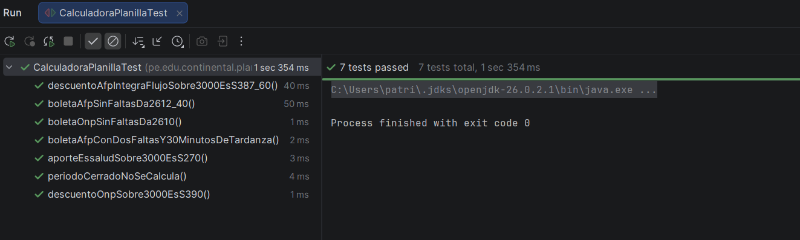

# Pruebas del cálculo de planilla

Objetivo específico 5: verificar la exactitud de los cálculos comparándolos
con cálculos hechos a mano.

## Casos de prueba

| N° | Caso | Cálculo a mano | Esperado | Resultado del sistema |
|---|---|---|---|---|
| 1 | Descuento AFP Integra (flujo), sueldo S/ 3,000 | 300.00 + 41.10 + 46.50 | S/ 387.60 | ✔ |
| 2 | Descuento ONP, sueldo S/ 3,000 | 3,000 × 13 % | S/ 390.00 | ✔ |
| 3 | Aporte EsSalud, sueldo S/ 3,000 | 3,000 × 9 % | S/ 270.00 | ✔ |
| 4 | Boleta AFP sin faltas | 3,000 − 387.60 | Neto S/ 2,612.40 | ✔ |
| 5 | Boleta ONP sin faltas | 3,000 − 390.00 | Neto S/ 2,610.00 | ✔ |
| 6 | Boleta AFP, 2 faltas y 30 min de tardanza | 3,000 − 200.00 − 6.25 − 360.95 | Neto S/ 2,432.80 | ✔ |
| 7 | Período cerrado | — | Lanza `ReglaPlanillaException` | ✔ |

## Salida de la ejecución

Ejecutado en IntelliJ IDEA (JDK 26) sobre `CalculadoraPlanillaTest`:

```
7 tests passed, 7 tests total, 1 sec 354 ms
Process finished with exit code 0
```

## Evidencia

Test en verde
