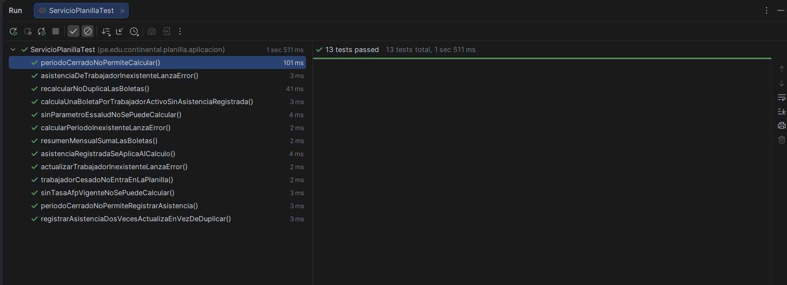
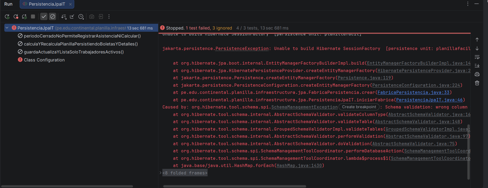

## 1. Pruebas del cálculo de planilla

Objetivo específico 5: verificar la exactitud de los cálculos comparándolos
con cálculos hechos a mano.

## Casos de prueba

| N° | Caso | Cálculo a mano | Esperado | Resultado del sistema |
|---|---|---|---|---|
| 1 | Descuento AFP Integra (flujo), sueldo S/ 3,000 | 300.00 + 41.10 + 46.50 | S/ 387.60 | ✔ |
| 2 | Descuento ONP, sueldo S/ 3,000 | 3,000 × 13 % | S/ 390.00 | ✔ |
| 3 | Aporte EsSalud, sueldo S/ 3,000 | 3,000 × 9 % | S/ 270.00 | ✔ |
| 4 | Boleta AFP sin faltas | 3,000 − 387.60 | Neto S/ 2,612.40 | ✔ |
| 5 | Boleta ONP sin faltas | 3,000 − 390.00 | Neto S/ 2,610.00 | ✔ |
| 6 | Boleta AFP, 2 faltas y 30 min de tardanza | 3,000 − 200.00 − 6.25 − 360.95 | Neto S/ 2,432.80 | ✔ |
| 7 | Período cerrado | — | Lanza `ReglaPlanillaException` | ✔ |

## Salida de la ejecución

Ejecutado en IntelliJ IDEA (JDK 26) sobre `CalculadoraPlanillaTest`:

```
7 tests passed, 7 tests total, 1 sec 354 ms
Process finished with exit code 0
```

## Evidencia

Test en verde


## 2. Servicio de planilla (ServicioPlanillaTest)

| N° | Caso | Esperado | Resultado |
|---|---|---|---|
| 8 | Planilla con 1 trabajador AFP y 1 ONP, sin asistencia registrada | Netos S/ 2,612.40 y S/ 2,610.00 | ✔ |
| 9 | Asistencia registrada (2 faltas, 30 min) se aplica al cálculo | Descuentos S/ 567.20, neto S/ 2,432.80, EsSalud S/ 251.44 | ✔ |
| 10 | Registrar asistencia dos veces el mismo mes | Se actualiza, no se duplica | ✔ |
| 11 | Recalcular la planilla del mismo período | Sigue habiendo 1 boleta por trabajador | ✔ |
| 12 | Resumen mensual (1 AFP + 1 ONP) | Remuneraciones 6,000.00; descuentos 777.60; neto 5,222.40; EsSalud 540.00 | ✔ |
| 13 | Trabajador cesado | No genera boleta | ✔ |
| 14 | Calcular planilla de período cerrado | Lanza `ReglaPlanillaException` | ✔ |
| 15 | Registrar asistencia en período cerrado | Lanza `ReglaPlanillaException` | ✔ |
| 16 | Asistencia de trabajador inexistente | Lanza `TrabajadorNoEncontradoException` | ✔ |
| 17 | Calcular un período inexistente | Lanza `PeriodoNoEncontradoException` | ✔ |
| 18 | Actualizar trabajador inexistente | Lanza `TrabajadorNoEncontradoException` | ✔ |
| 19 | AFP sin tasa vigente | Lanza `ReglaPlanillaException` | ✔ |
| 20 | Falta el parámetro EsSalud | Lanza `ReglaPlanillaException` | ✔ |

## Salida de la ejecución

Ejecutado en IntelliJ IDEA (JDK 26) con *Run All Tests*:

```
13 tests passed, 13 tests total, 1 sex 511 ms
Process finished with exit code 0
```

## Evidencia


## 3. Prueba de Integració (PersistenciaJpaIT)
Objetivo: verificar mediante **Testcontainers (PostgreSQL 17)** e **Hibernate ORM (`validate`)** que el mapeo de entidades coincide con `esquema.sql` y que las operaciones transaccionales persisten correctamente en base de datos real.

### Hallazgo durante la validación de esquema

* **Incidencia:** Al iniciar `FabricaPersistencia`, Hibernate lanzó `SchemaManagementException` porque `empresa.ruc` (`CHAR(11)`) y `trabajador.dni` (`CHAR(8)`) están definidos como `bpchar` en PostgreSQL, mientras que el mapeo por defecto de `String` esperaba `VARCHAR`.
* **Solución:** Se agregó `@JdbcTypeCode(SqlTypes.CHAR)` en los atributos `ruc` (`Empresa.java`) y `dni` (`Trabajador.java`), manteniendo intacto `esquema.sql`.

### Casos de prueba

| N° | Caso | Esperado | Resultado |
|---|---|---|---|
| 21 | Guardar trabajador activo, actualizar otro a `CESADO` y listar activos | Retorna únicamente al trabajador activo | ✔ |
| 22 | Calcular planilla con faltas/tardanzas y recalcular el mismo período | Persiste boletas y detalles; el recálculo reemplaza sin violar `UNIQUE (id_trabajador, id_periodo)` | ✔ |
| 23 | Registrar asistencia o calcular planilla sobre un período `CERRADO` | Lanza `ReglaPlanillaException` y revierte la transacción | ✔ |

Pruebas en rojo evidencia
